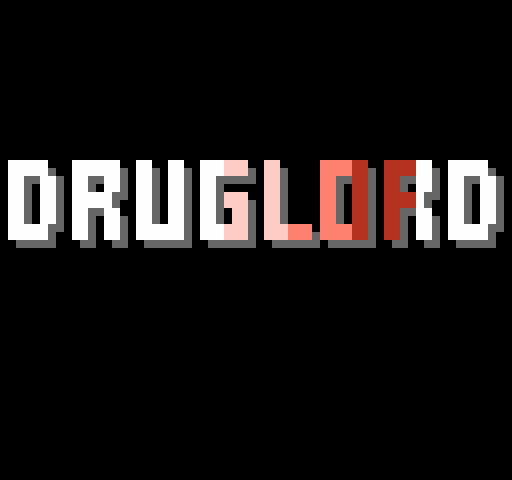
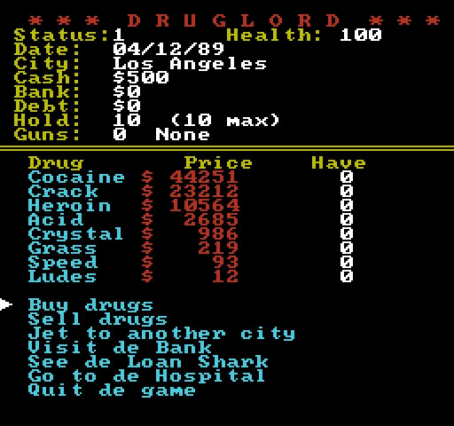
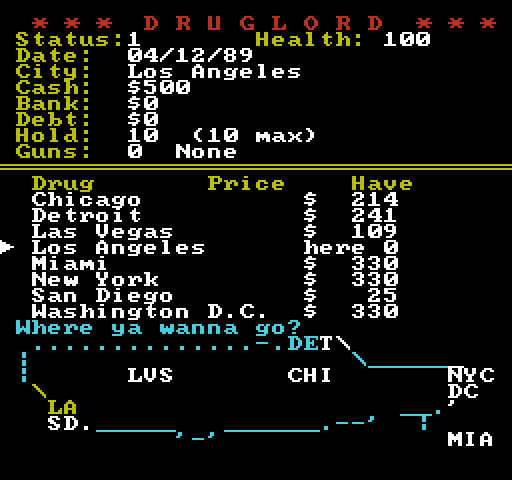
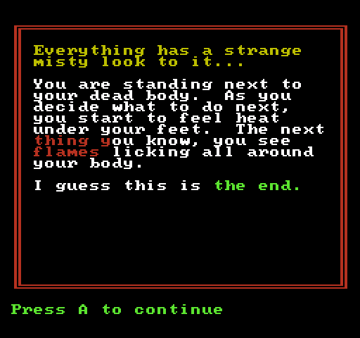
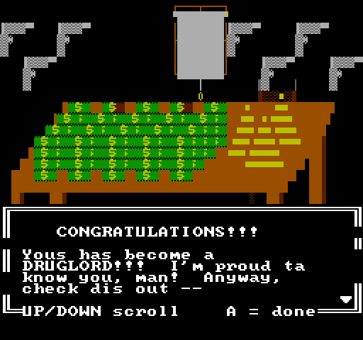

# DRUGLORD for the NES

A separate, playable port of DRUGLORD (Phil Erwin, 1991-93) to the NES, written in C for cc65.
It is **not** part of the byte-matched C source in https://github.com/justz00t/druglord, which is never touched.

`druglord.nes` is the ready-to-run ROM (mapper 2 / UxROM, 128 KB PRG, CHR-RAM, 8 KB battery-backed WRAM). Any NES emulator will run it. The high score table is kept in the battery-backed WRAM (with a checksum), so it survives power-off.

`druglord-debug.nes` is the same game plus a **debug menu**: press SELECT and START together on the main menu to pick any event or screen (cop fight, every random event, mugger variants, thugs, death, win, replay prompt, NOTICE, credits, title) or open the **sound test**, which plays every sound effect and the title music. The regular ROM has no debug menu.

## Controls

| Button | Does |
|---|---|
| D-pad up/down | move the cursor in a menu |
| D-pad left/right | number entry: move between digits |
| D-pad up/down (number entry) | change the digit |
| SELECT (number entry) | fill in the largest sensible amount (most you can buy, everything you own, everything you owe) |
| A | choose / confirm / continue |
| B | cancel / go back |
| START | start from the title screen |

## What is in it

The whole game: 8 cities and 8 drugs, buying and selling, the air fares, the bank, the loan shark and his thugs,
the hospital, the ten random events (cops fight with friends or a posse and guns, mugger, trenchcoat, gun smuggler, blackmail,
price events, brownies), the status/rank system, the final score and the NOTICE screen when you quit.
**High scores:** the top 10 (3-letter initials, score and rank) are kept in the cartridge's battery RAM, so an emulator keeps them in its save file. A fresh cartridge starts with ten made-up players. When you win and your score makes the table you enter your initials (UP/DOWN letter, LEFT/RIGHT or A/B move, START = done). The table also flashes for a second before the title screen whenever you leave a game (not between the credits and the title).

On start-up the credits play (about 5 seconds): "NES port by justz00t" falls into place letter by letter in a random order (sprites that turn into background tiles as they land) and flashes, then the three red credit lines fade in from black and flash. Then comes the title screen: just the DOS title art (converted from the original's `titleArt`, one text cell = 4 x 8 pixels) in blue, and PRESS START in white. A red snake crawls across the logo and back (a bright red head, its tail fading to pink; it moves by rewriting the logo's attribute bytes in vblank), then the whole logo flashes red, blue, red, blue, and the snake sets off again. The title music is the piano riff of `tools/title.mid` on pulse 1, pulse 2 and triangle with a drum pattern on the noise channel (16 bars, about 41 seconds). After 60 seconds on the title screen the high score table is shown for 2 seconds, then the title again (START on the table starts a game too).

The main screen has its own music, a boom-bap beat at 104 BPM in C minor (`tools/menu_song.py` writes `menu.h`; `menu_frame()` plays it): triangle bass with a pitch-drop thump under each kick, chord stabs as a fast arpeggio on pulse 2, a hook on pulse 1 in bars 5-8, drums on the noise channel. Sound effects take over pulse 2 and the noise while they play; full-screen pages (events, the cops, death, the win) stop it. Quitting shows the NOTICE screen; A returns to the title screen.

| main screen | jet (the map shows where you are) | death |
|---|---|---|
|  |  |  |

When you win, the DOS end scene is drawn (the table, the lamp and the coins, from the original's `endScene` data at 3 x 8 pixels per text cell, in its own 4 KB tile set that is loaded into the second pattern table for that screen): a pistol for each gun you own, then the stacks of money pile up with rising beeps, one stack for every $100,000 and a new layer every $2,000,000, and the score list scrolls in a box over the bottom of it (UP/DOWN, A = done), as on the PC.

**Every sound effect and all the in-game music is a MIDI file** in `tools/snd/`, played by one MIDI player (`seq.c`). `tools/mid2nes.py` converts them at build time, so you can open any of them in a MIDI editor, change it, and rebuild. MIDI channel 1 is pulse 1, channel 2 pulse 2, channel 3 the triangle and channel 10 the noise channel (drums and noises); velocity is volume, the program picks the pulse sound, and pitch bend gives sweeps. The top of `tools/mid2nes.py` has the full rules. `sfx_NAME.mid` is a sound effect and `song_NAME.mid` a looping piece of music. `tools/make_snd.py` wrote the originals and can write them again; the build never runs it.

* **Sound effects:** a sound effect takes pulse 2 and the noise channel (and the other two voices when no music is playing), so the music carries on underneath. There is one for nearly everything: the cash register on a deal, a double buzzer when you can't, coins in and out of the bank, the bell on the bank's counter, Guido's three notes at the loan shark, a heart monitor at the hospital and a sparkle when you're patched up, the jet spooling up and flying off, a different shot for each gun, a fist, a bullet landing, the baseball bat, a street tip, the factory blowing up, the zip of a new trenchcoat, guns being racked, a blackmail sting, running feet, and a short fanfare when the cops are down. The police siren (a slow wail, then four yelps, the two pulses beating) and the EXTRA! news-wire xylophone are the ones the game already had, now as MIDI. A press of A cuts a long effect short.
* **Music:** the cop fight has its own theme (fast, A minor: the tune and bass are on the two voices the gunshots don't take), Guido's thugs and the mugger get a slow heavy one, the other event pages a sneaky street walk, the death screen the funeral march (Chopin, 1839), and the notice on the way out a quiet closing piece. The event music stops for the sound of how the event turned out.

The debug ROM's sound test plays every one of them by name.

The rules, odds and formulas are the DOS original's (see "GAME RULES AND FORMULAS" in `c/DRUGLORD.C` of https://github.com/justz00t/druglord), including its
random number generator.  The NES has no floating point, so the formulas are redone with integers in a way that gives
the same numbers (price multipliers, air fares, loan terms, interest, the coat prices and the score tables).
Original quirks are kept, e.g. banking does not pass a day and events only happen once per city.

## What is different from the PC version

* The screen is 32 x 30 text tiles, so the layout is rearranged and events and dialogues fill the whole screen.
* Controller input instead of a keyboard.
* No save game (the high-score table is kept in battery RAM instead).
* The cop fight screen is simplified (one action line at a time), but uses the same rules.
* The death screen is the original's text in its frame (no tombstone).
* The jet menu shows a small map of the cities (outline blue, cities white, yours yellow).
* One colour scheme on every screen: white for the text and values, yellow for labels, questions and prompts, red for commands, list arrows, headlines and bad news; health runs from white down to dark red.

## Build

`./build.sh` builds both ROMs (`druglord.nes` and `druglord-debug.nes`, the latter with `-DDEBUG`); it needs cc65 on the path (2.18 or later, e.g. Ubuntu's `apt install cc65`); set `CC65_HOME` if it is not installed system-wide).
The source is split by PRG bank: `druglord.c` (fixed bank: engine, rules, main loop), `bank_a.c` (events, menus), `bank_b.c` (start/end screens, title, debug), `hiscore.c` (high scores, bank 4), `music.c` + `victory.c` + `seq.c` (the main-menu song, the victory tune, and the MIDI player with its sound effects and music, bank 3), `crt0.s` (start-up, bank switching), `dl.h` (shared declarations). Calls into the switchable banks go through `_bankcall` (cc65 `wrapped-call`). PRG banks: 0 = A, 1 = B, 2 = the tile sets and pictures, 3 = the music and sound effects, 4 = the high scores, 5 = the cop fight (`fight.c`), 6 = the easter-egg song, 7 = fixed.
`tools/mkdata.py` creates the tiles (`chr.bin`), the title data (`title.h`), the music tables (`music.h`) and the score tables (`tables.h`).
The font is the IBM PC 8x8 font, so tile numbers are DOS characters (tile + 0x80 is the inverted glyph, used as highlight; tiles 8-12 are the block and shade characters).
PRG bank 2 holds three 4 KB tile sets: the game's (pattern table 0), the title's (the font plus the logo tiles built from `tools/title_art.bin`, the DOS `titleArt` data) and the end scene's (the font plus the picture tiles from `tools/end_scene.bin` and `tools/gun_sprite.bin`, the stacks of money and the pistol); the last two are loaded into pattern table 1 as needed (`load_pt1`).

## Victory tune

After a win, the initials screen plays an original victory tune (`victory.c`: C major, about 138 BPM, a 4-bar loop on all four channels), and it carries on into the high score table that follows. The table never plays it when it is reached any other way (the title screen's attract mode, the end of a game). The tune's code and data live in PRG bank 3 with the other music and are called through the bank trampoline.

## Easter egg

Sell **more than 100 cocaine in one sale** and the main-screen music changes to the easter-egg song for the rest of that game (until you win, die or quit; a new game starts with the normal music again). The debug ROM's "Coke+200" entry gives you enough cocaine to try it.

The song comes from a MIDI file, converted at build time by `tools/mid2nes.py` (a generic import: at every 16th note the lowest sounding note below middle G goes to the triangle, the highest two others to the pulses, the drum channel is ignored and the game adds its own beat; the first tempo is used; the song loops, and is cut at a bar line if it is too long for the 16 KB of PRG bank 6, which it has to itself). It plays on the same MIDI player as the rest of the sound, and the debug ROM's sound test has it as "easter egg".

* `tools/easter_default.mid` is an original placeholder tune.
* To use your own song, save it as **`tools/easter_local.mid`** and run `./build.sh`. That file, and the generated `easter.bin`, are in `.gitignore`, so they stay on your machine. The ROM you build then contains your song: keep that ROM to yourself (don't commit it).
